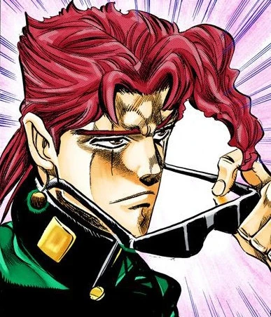
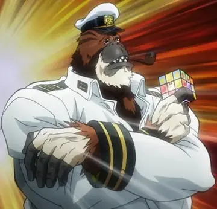

  

    <!-- Questão 1 -->
    

      <h4>Questão 1: Escolha a imagem correta</h4>
      

        <button class="opt-btn" onclick="processAnswer(1, false)">
          
        </button>
        <button class="opt-btn" onclick="processAnswer(1, true)">
          
        </button>
        <button class="opt-btn" onclick="processAnswer(1, false)">
          
        </button>
      

    

    <!-- Questão 2 -->
    

      <h4>Questão 2: Qual é o verdadeiro protagonista?</h4>
      

        <button class="opt-btn" onclick="processAnswer(2, true)">
          
        </button>
        <button class="opt-btn" onclick="processAnswer(2, false)">
          
        </button>
      

    

    <!-- Questão 3 -->
    

      <h4>Questão 3: Errou faz?</h4>
      

        <button class="opt-btn" onclick="processAnswer(3, false)">
          
        </button>
        <button class="opt-btn" onclick="processAnswer(3, true)">
          
        </button>
      

    

    

  

  <!-- Conteúdo Secreto -->
  

    

      <h3 style="margin-top:0;">Quem é Cosmo?</h3>
 
Cosmo é muitas coisas, pode-se dizer que Cosmo é o <i>Marrentinho de Camaragibe</i> ou que Cosmo é o <i>Paraibinha de Olinda</i>, mas pra mim não existe adjetivo que consiga descrever com precisão quem é Cosmo.

      
Ele começa sendo um número que você não sabe qual é, que te manda uma figurinha assustadora no telegram, você acha que seu número na verdade vazou, anos depois você percebe que era apenas a primeira lembrança de alguém que você não consegue mais se imaginar sem.

      
QUEM é esse cara? que na verdade parece saber de tudo, parece te conhecer mesmo sem ter trocado tantas palavras e consegue entender cada coisa que você passa? Que sempre está lá quando você precisa dele? E Por quê? Não é lógico ter alguém que se importa tanto assim com vocÊ de uma hora pra outra, ainda mais quando você aparentemente não fez nada para conquistar todo esse afeto, você nem ao menos viu ele pessoalmente!

      
Uma vez, no sexto ou nono ano, tive que fazer um texto sobre o que era amor fraternal. Parece piada mas eu nem sequer sabia o significado da palavra, nunca tive irmãos ou sequer primos tão próximos que eu podia considerar como irmãos. Hoje, chorando que nem criança uns quase 10 anos depois, finalmente entendi.

      
Hoje consigo dizer com certeza o que é esse tipo de amor, essa admiração que se tem por alguém, uma coisa que é difícil de se colocar em palavras e ações.

      
Quem é Cosmo? Cosmo é o Homem que me inspiro. O filho que quero ser, o profissional que quero me tornar, com a maturidade que quero ter e competência e força de vontade que consigo só sonhar com. A figura masculina que se tornou mais importante na minha vida em menos de 5 anos, que me inspira a ser alguém melhor cada dia que passa, que não tem vergonha de ser.

      
Talvez por isso ele não leia obras de ficção, não existe nenhum gibi que tenha uma figura de super-herói que se compare a Cosmo, pelo menos pra mim.

      
Cosmo é o amigo, o irmão, o tio, o sobrinho, o filho, o colega de classe, o doutor. Uma pena que não seja todo mundo que tenha um Cosmo em sua vida, pois a minha se tornou infinitamente mais legal com um.

      
 E que nem aquela frase que um filósofo disse uma vez, parafraseando: "fortinho, trabalhador e ainda faz med? até eu", sei lá não me lembro.

      
Enfim, no momento q estou aqui me acabando de chorar vc deve estar feliz e sorridente em um postinho de Camaragibe fazendo o que ama e o que sempre sonhou em ser, ainda bem!!

      
Que tudo que você queira se realize, você merece tudo de bom e sabe disso.

      
Espero que não tenha clicado na estrela de Davi.

  
 

  <audio id="secret-audio" src="/assets/audio/secret.aac" preload="auto"></audio>

